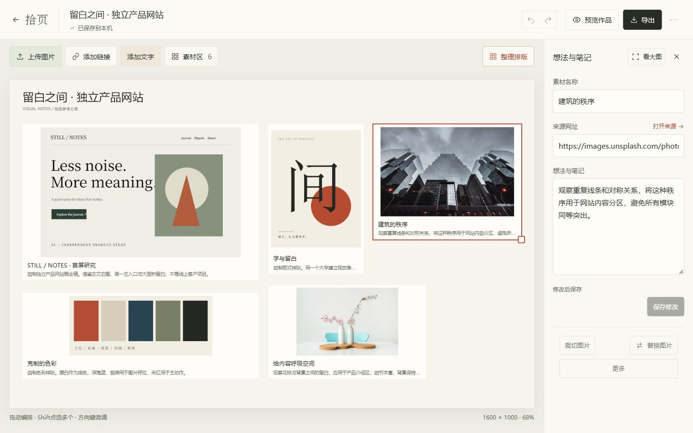
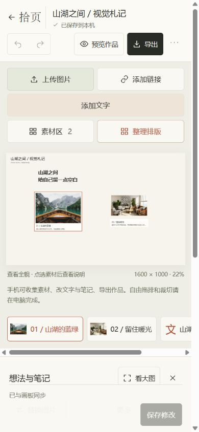
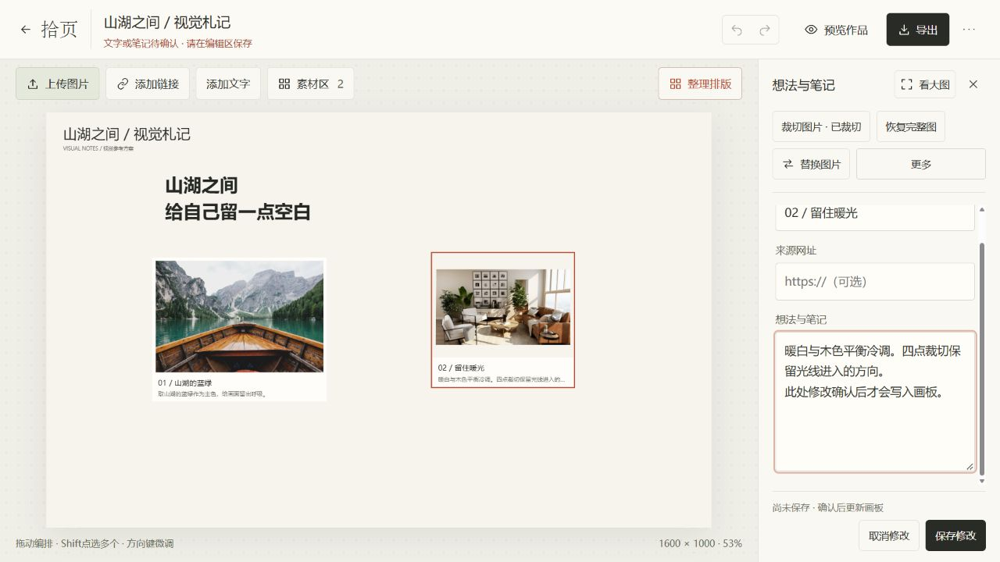

# 拾页 · 视觉灵感工作台

把散落的参考图片、来源与想法，整理成一页可保存、可分享的视觉笔记。

拾页是一个用 Vue 3、TypeScript 和 Vite 构建的个人项目，面向收集视觉参考、制作灵感板和梳理设计想法的场景：先收集素材，再自由编排图片与文字，保留来源和笔记，最后导出作品或完整备份。

**[在线体验 →](https://lsc-261013.github.io/shiye-workbench/)** · [使用流程](#从收集到作品) · [本地开发](#本地开发)

无需安装或注册。桌面适合自由编排和精细裁切；手机适合收集素材、修改文字与笔记、查看和导出作品。

## 界面预览

公开示例「留白之间」的已保存编辑画面：把页面样张、字体、色彩和摄影参考组织在同一张画板上，同时保留每份素材的来源与笔记。截图来自实际运行的应用。



<details>
<summary>查看手机轻量编辑界面（390px 视口）</summary>



</details>

## 从收集到作品

1. **收集参考。** 上传图片或添加链接，素材先进入素材区。桌面从左侧素材栏拖到画板，也可点击添加；新素材不会挪动、缩放或重新排列已有对象，同一素材可以多次使用。
2. **自由编排。** 拖动、缩放、重叠图片与文字，多选后对齐或均分。只有主动点击「整理排版」才会自动整理，添加素材和文字不会触发重排。
3. **裁切与记录。** 图片支持原图比例、1:1、4:3、16:9 等规则裁切，以及四点自由区域裁切。四点控制可见轮廓，不做透视变形。每张素材可保留名称、来源和完整笔记。
4. **放心修改。** 工具栏和快捷键共用撤销/重做逻辑，支持连续撤销；未确认的文字与笔记会显示待保存提示，并在离开编辑或导出时提供保存/放弃保护。
5. **保存与带走。** 草稿保存在当前浏览器，可刷新后继续编辑；导出 PNG 作品、完整 TXT 清单或可恢复的 JSON 备份。换设备或浏览器时，用 JSON 导入恢复。

空白画板提供上传第一张图片和直接写文字的入口。桌面编辑栏的保存/取消保持可见，手机保留底部保存操作；窄屏工具栏会调整排列，方便预览与导出。

<details>
<summary>查看编辑流程：待确认提示与固定保存操作</summary>

下图演示笔记尚未确认时的状态；点击「保存修改」后才会将输入更新到画板。



</details>

## 使用边界与数据

- 画板为固定 **1600 × 1000**。桌面支持自由拖排、精细裁切与多选；手机保留整板概览、辅助添加、文字/笔记编辑、历史操作和导出，已有裁切可以显示并导出。
- **没有账号或云同步。** 草稿与图片保存在当前浏览器的 IndexedDB 中；不同浏览器、域名或端口的数据彼此独立。清理浏览器数据、换设备或切换作品前，请先导出 JSON。导入前也建议备份现有草稿。
- 支持 PNG、JPEG、WebP；单图最大 12MB、4000 万像素，最多 100 份素材、150 个画板对象。历史最多 30 步，刷新后不保留撤销历史；「整理排版」最多处理 12 个元素。
- 对象复制粘贴使用应用内会话快照，仅在本次编辑会话中使用，不读取系统剪贴板中的外部图片。
- PNG 用于分享画面，TXT 保留完整笔记，JSON 保留原图、文字、裁切和布局以便恢复。请自行确认下载文件已保存到磁盘。

## 本地开发

推荐使用 **Node.js 24.x** 和 npm，与 CI 环境一致；既有实测版本为 24.15.0。下列命令使用 `--configLoader native` 加载 `vite.config.ts`，依赖 Node 的原生 TypeScript 支持，不能仅按 Vite 的最低 Node 版本选择环境。参见 [Node TypeScript 支持](https://nodejs.org/api/typescript.html)与 [Vite 配置加载](https://v7.vite.dev/config/)。仓库提供锁文件，安装依赖使用 `npm ci`。

```bash
git clone https://github.com/lsc-261013/shiye-workbench.git
cd shiye-workbench
npm ci
npm run dev -- --port 5186 --strictPort --configLoader native
```

打开终端输出的本地地址（默认绑定 `127.0.0.1`）。请通过开发服务器或预览服务器访问，不要直接双击 `index.html`。

| 命令 | 用途 |
| --- | --- |
| `npm run check` | TypeScript 与 Vue 类型检查 |
| `npm test -- --configLoader native` | 运行现有 Vitest 测试 |
| `npm run build -- --configLoader native` | 类型检查并构建到 `dist/` |
| `npm run preview -- --port 4186 --strictPort --configLoader native` | 预览已生成的生产构建 |
| `npm run build:pages` | 按 `/shiye-workbench/` 资源前缀构建并检查 Pages 产物 |

开发和预览端口对应不同的草稿存储。需要迁移时，请通过应用导出、导入 JSON。

## 实现与验证

生产依赖为 Vue 3；TypeScript 负责类型检查，Vite 负责开发与构建，Vitest 与 fake-indexeddb 覆盖数据、几何、历史和存储等逻辑。图片及画板在浏览器中处理，草稿使用 IndexedDB，PNG 通过 Canvas 导出。

实现围绕三个使用问题展开：素材与画板实例分离，让新增素材和单次裁切不破坏已有排版；编辑输入先暂存、确认后提交，避免未保存内容被误当作已保存；画板动作进入统一历史，使按钮与连续撤销/重做保持一致。

| 目录 | 职责 |
| --- | --- |
| `src/components/` | 页面与编辑工具 |
| `src/composables/` | 输入草稿与交互动作 |
| `src/lib/` | 裁切几何、排版、历史、绘制及存储 |
| `tests/` | 逻辑与数据风险测试 |
| `docs/` | 使用说明、验证证据与交接记录 |

最近一次功能发布通过类型检查、6 个测试文件的 45 项测试及生产构建，并完成拖入、裁切、连续撤销、导出和恢复的操作复核。具体验证范围与兼容性限制见[质量交接的验证记录](docs/HANDOFF-QUALITY-2026-10-13.md#验证与归属)和[未测项](docs/HANDOFF-QUALITY-2026-10-13.md#限制与回退)。

项目通过需求与交互取舍、问题定位、体验验收持续迭代，结合 AI 工具推进代码实现、自动化测试与操作复核。

正式站点使用免费的 GitHub Pages，推送 `main` 后由[现有工作流](.github/workflows/pages.yml)执行检查、构建和发布。当前线上提交可查看[版本清单](https://lsc-261013.github.io/shiye-workbench/release.json)。站点产物仅包含应用和公开示例，不包含私人草稿或备份。

进一步阅读：[当前状态](docs/STATUS.md) · [功能与数据交接](docs/HANDOFF-ROUND-FOUR-2026-10-07.md) · [连续撤销修复](docs/FIX-CONTINUOUS-UNDO-2026-10-07.md) · [发布与恢复记录](docs/RELEASE-2026-10-07.md) · [素材与依赖来源](docs/SOURCES.md)
